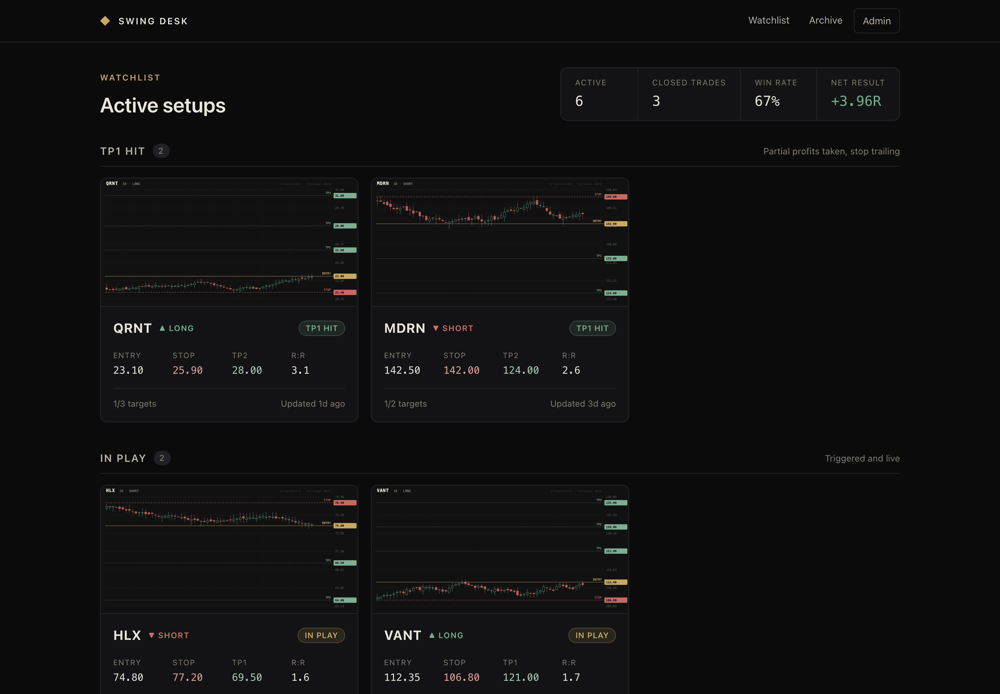
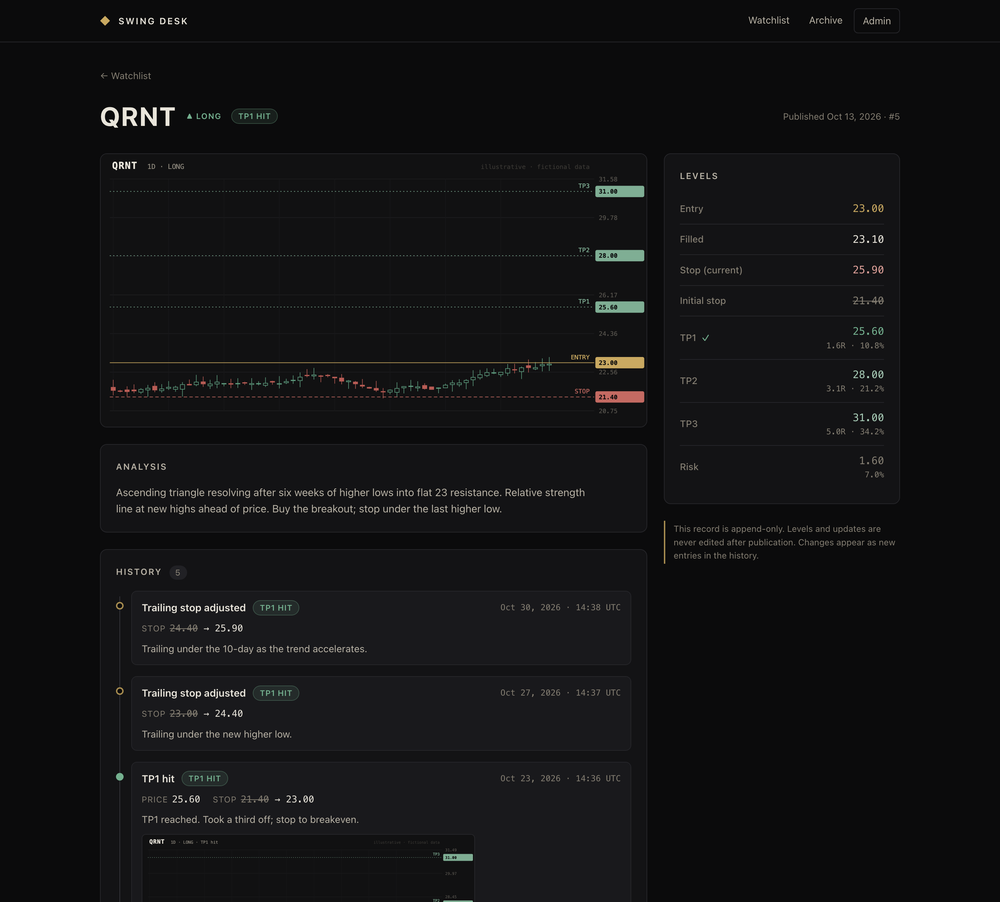
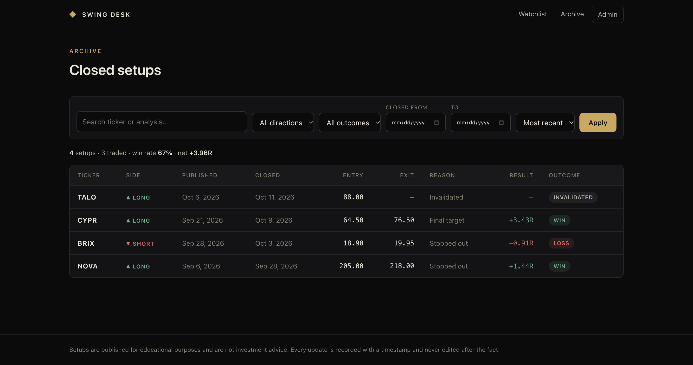
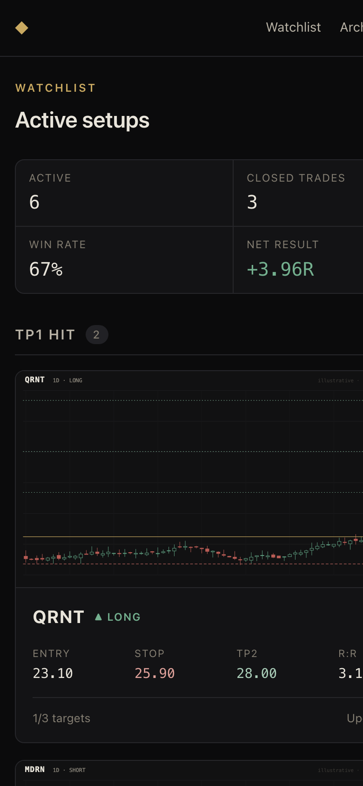

# Swing Desk

A Next.js + SQLite app for publishing and tracking swing trading setups.

- **Public:** watchlist of active setups (`/`), a page per setup with its full history timeline (`/setups/[id]`), and a searchable, filterable archive of closed setups (`/archive`).
- **Admin** (`/admin`): create setups (ticker, long/short, analysis, entry, stop, any number of targets, chart image) and record updates.



<details>
<summary>More screenshots</summary>

**Setup page with history timeline**



**Archive with search and filters**



**Mobile**



</details>

## Lifecycle and history

```
WATCHING ──trigger──▶ IN PLAY ──target hit──▶ TP1 HIT ──▶ CLOSED
    │                    │  ▲ trailing stop      │  ▲ trailing stop / more targets
    └──invalidate──▶ CLOSED   └──── close (stopped / target / manual) ────┘
```

Every change is a new row in `setup_events`, stamped with the time it was recorded and holding the status and stop that applied after it. Current state is derived from the latest event (`setup_state` view). Nothing is ever overwritten:

- SQLite triggers reject every `UPDATE` and `DELETE` on `setups`, `setup_events` and `images`.
- The levels a setup was published with (entry, initial stop, targets) are locked. Fills, target hits, stop moves, closes and notes are appended.
- Once a trade is live, the stop can only trail in the trade's favour.
- R multiple = exit vs. fill, divided by the planned risk (entry to initial stop), on the full position.

## Run locally

```bash
npm install
npm run dev        # http://localhost:3000
```

On first request the app creates `data/swing.db` and seeds 10 fictional setups. Admin password is `admin` in dev unless `ADMIN_PASSWORD` is set (see `.env.example`).

```bash
npm run db:seed    # wipe and re-seed the demo data
```

## Deploy to Vercel

Vercel's filesystem is read-only and ephemeral, so a local SQLite file can't persist there. The app uses **libSQL**, which reads the same SQLite file locally and connects to a hosted SQLite database ([Turso](https://turso.tech)) in production. No code changes are needed between the two.

1. Create a database: `turso db create swing-desk`, then `turso db show --url swing-desk` and `turso db tokens create swing-desk`.
2. Seed it (optional): `TURSO_DATABASE_URL=… TURSO_AUTH_TOKEN=… npm run db:seed`. The schema is otherwise created automatically on first request.
3. Import the repo in Vercel and set these environment variables:
   - `TURSO_DATABASE_URL`, `TURSO_AUTH_TOKEN`
   - `ADMIN_PASSWORD` (required; admin is disabled in production without it)
   - `ADMIN_SECRET` (a long random string for signing the session cookie)

Without `TURSO_DATABASE_URL`, a Vercel deployment still runs as a demo: it uses `/tmp/swing.db`, re-seeded on each cold start. The admin dashboard warns that changes won't persist.

Chart images are stored in the database as blobs (PNG/JPEG/WebP/GIF, verified by file signature, up to 4 MB to stay under Vercel's request limit) and served from `/api/images/[id]` with immutable caching.

## Layout

```
src/lib/db.ts          schema, append-only triggers, state view, connection
src/lib/setups.ts      queries + the transition rules (appendEvent)
src/lib/seed.ts        10 fictional setups with backdated histories
src/lib/chart-svg.ts   generates the illustrative seed charts
src/lib/auth.ts        password check + signed session cookie
src/proxy.ts           redirects unauthenticated /admin requests
src/app/…              public pages, admin pages, server actions
```

All tickers, prices and charts in the seed data are invented. Nothing here is investment advice.
